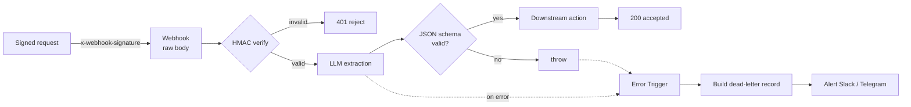

# Production-Grade n8n Defensive Automation Template

A reusable n8n workflow that shows how to run an AI pipeline **without leaving the three holes that sink most automations**: unauthenticated webhooks, unchecked LLM output, and silent failures.

Most n8n tutorials wire a public webhook straight into an LLM and hope for the best. That is fine until someone POSTs a forged payload, the model returns malformed JSON into your database, or a node fails at 3am and nobody notices. This template closes all three - and nothing else. It is a clean starting point you fork and extend, not a product.

Built by [CyberResonance](https://github.com/CyberResonance) - security-first automation engineering.

---

## The three pillars



Plain-text view of the same flow:

```
POST /secure-intake ──> [Webhook] ──> [HMAC Guard] ──> {Signature valid?}
                                                          │ false ──> 401 reject
                                                          │ true
                                                          ▼
                                   [LLM Extraction] ──> [Validate JSON Schema]
                                                          │ invalid ──> throw ─┐
                                                          │ valid              │
                                                          ▼                    │
                                   [Downstream Action] ──> 200 accepted        │
                                                                               │
   any failure, anywhere ──> [Error Trigger] ──> [Dead-Letter Record] ──> [Alert]
```

| # | Pillar | What it proves | Where |
|---|--------|----------------|-------|
| 1 | **Signature-verified ingestion** | A forged/tampered request is rejected with `401` before the pipeline runs. HMAC-SHA256 over the raw body, constant-time compare. | `HMAC Signature Guard` node · [runbook](docs/runbook.md#pillar-1---signature-verified-webhook-ingestion) |
| 2 | **Schema-validated AI output** | Malformed or hallucinated LLM output is caught and dead-lettered, never propagated. | `Validate Against JSON Schema` node · [`examples/intake.schema.json`](examples/intake.schema.json) |
| 3 | **Dead-letter queue + replay** | No silent failures. Every error is captured, alerted, and replayable. | `Error Trigger` -> `Alert` · [dead-letter & replay](docs/dead-letter-and-replay.md) |

Baseline hygiene throughout: **secrets via `.env` only** (zero hardcoded keys in the JSON), self-hosted Docker, least-privilege.

---

## Quickstart

```bash
# 1. Configure secrets (never commit the real .env)
cp .env.example .env
#    then edit .env:
#      WEBHOOK_SIGNING_SECRET  (openssl rand -hex 32)
#      LLM_API_BASE_URL / LLM_API_KEY / LLM_MODEL
#      ALERT_WEBHOOK_URL       (Slack incoming webhook or Telegram bot URL)

# 2. Run n8n
docker compose up -d
#    open http://localhost:5678

# 3. Import the workflow
#    n8n UI -> Workflows -> Import from File
#    -> workflow/signed-ai-intake-template.json

# 4. One-time wiring: Settings -> Error Workflow -> select THIS workflow
#    (so the Error Trigger fires on its own failures - see runbook)

# 5. Activate, then send a correctly signed request
WEBHOOK_SIGNING_SECRET=$(grep ^WEBHOOK_SIGNING_SECRET .env | cut -d= -f2) \
  ./examples/sign_and_send.sh \
  http://localhost:5678/webhook/secure-intake examples/sample-payload.json
```

A valid signature returns `200 { "status": "accepted", "result": {...} }`.
Change one byte of the body or secret and you get `401 invalid_signature`.

---

## Configuration

All configuration is environment variables - see [`.env.example`](.env.example) for the full list and comments. The LLM node targets any OpenAI-compatible `/chat/completions` endpoint, so it works unchanged against OpenAI, an Anthropic-compatible proxy, or a local Ollama model.

## Repository layout

```
.
├── README.md
├── LICENSE                       # MIT (recommended - confirm before publishing)
├── .env.example                  # placeholder secrets only
├── .gitignore
├── docker-compose.yml            # minimal self-hosted n8n
├── workflow/
│   └── signed-ai-intake-template.json   # import this
├── docs/
│   ├── runbook.md                # how all three pillars work + required setup step
│   └── dead-letter-and-replay.md # DLQ record shape + the two replay paths
└── examples/
    ├── intake.schema.json        # the strict output contract (JSON Schema 2020-12)
    ├── sample-payload.json
    └── sign_and_send.sh          # client side of the signed webhook
```

## Extending it

- **Pillar 1:** swap the header name / scheme to match your upstream (GitHub uses `x-hub-signature-256`, Stripe uses `Stripe-Signature` with a timestamp - same HMAC primitive).
- **Pillar 2:** replace `examples/intake.schema.json` with your own contract and update the validator node. Drop in `ajv` if you want a full JSON-Schema engine.
- **Pillar 3:** add a durable sink (Postgres/Redis/Airtable) as a second branch off the dead-letter record - see the production note in the DLQ doc.

## License

Recommended: **MIT** (permissive - the right choice for a lead-magnet template). A ready MIT `LICENSE` is included with placeholders for year and copyright holder. Confirm the holder name and license choice before publishing.

## Scope / safety

Local, synthetic-data template. The example webhook source is a benign demo; there is no scanning, probing, or action against any third-party system. Keep it that way when you adapt it.
